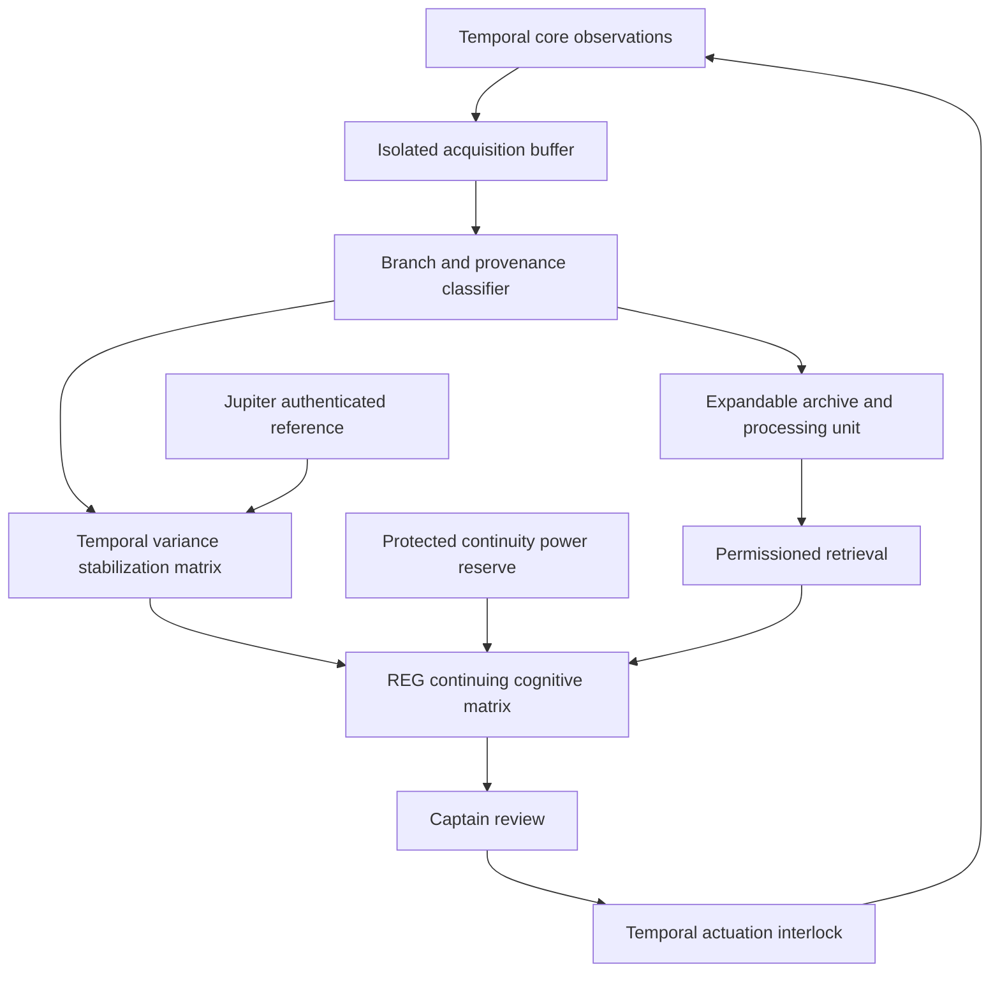

# STAR TREK: AVALON
## MEMORY’S FLAME
### The Place Where I Am
**By Noah Hawkes**  
Developed with AI drafting assistance under the creator’s direction.

**Era:** 2397, with proposed pre-2395 reconstruction.  
**Record date:** October 13, 2026.  
**Authority:** Noah.Physical.  
**Status:** Creator-directed development packet: reconciliation, new narrative, and fictional engineering schematic. The captain has directed solidification of REG’s chronology, a counselor consultation, additional storage/processing, and a temporal-variance stabilization design. This does not establish completed installation, commissioning, or blanket adoption of every new line.

## 1. The chronology I recommend

Jupiter is the beginning of Barclay’s neural entanglement with Sloan. Avalon’s 2395 catastrophe is his single biological death and irreversible continuation. By 2397 he is Avalon’s first officer, integrated with its holographic infrastructure and temporal core; Ashley independently commands Jupiter Station.

At Jupiter, before the catastrophe, Zimmerman’s adaptive holomatrix begins sustaining portions of Barclay’s ongoing cognition. The Sloan Deep File activates. Barclay remains biologically alive. The Doctor cannot simply terminate the matrix without risking the cognitive processes it supports.

The exact date, recovery duration, and protected integration procedure remain development choices. The older Jupiter manuscript’s fatal passages must be deliberately revised if this chronology is adopted. Preserve that manuscript and its original claims. This is reconciliation of drafts, not discovery of another Barclay death.

In 2395 the full Avalon ignition threatens Sol. Barclay reconstructs the Cytherian neural-interface chair and chooses to reconnect. Sloan’s existing pathway reactivates or escalates into temporal-field access. That bridge is proposed. The established catastrophe remains the decisive loss of biological support and continuation as REG-420.

The proposed default in 2397 is one continuing cognitive process with permissioned remote embodiment on Jupiter Station. This avoids silently creating autonomous copies. Cognitive migration, forks, and survival arrangements during total infrastructure loss require separate decisions.

REG can perceive all timelines and possibilities, as directed by the creator. Access is not a statement that every perception is a verified event, nor that finite storage holds an exhaustive lossless copy of infinity. The design below controls persistence, processing load, reference attribution, and foreground attention rather than shrinking his established capability.

## 2. The Place Where I Am

The captain had stopped looking at the chronology.

That was the first thing Reg noticed.

Two accounts of his death remained above the conference table, their headings illuminated with the same officious certainty.

Noah pushed them aside.

“You need to speak to the counselor again.”

Reg’s first response was almost automatic.

“I’m functioning within operational—”

“Reg.”

He stopped.

The Doctor, seated opposite him, said nothing. For once, the silence was more difficult than an objection.

“She specializes in temporal displacement,” Noah continued. “I think she can help you solidify where you are in the current timeline.”

Reg looked toward the viewport.

Avalon was docked. Jupiter Station’s running lights moved slowly across the glass as the docking structure rotated relative to the planet.

He could also see the berth empty.

The berth damaged.

The berth unchanged a century later.

He brought his attention back to the room.

“I know where I am, Captain.”

“Then tell me.”

“Jupiter system. Our home branch. The authenticated station reference identifies the current epoch as 2397.”

“And who are you talking to?”

“You.”

Noah waited.

Reg’s hands tightened.

“I’m talking to you,” he repeated, less mechanically.

The Doctor leaned forward.

“How much effort did that take?”

Reg did not answer.

Noah sat beside him rather than across the table.

“We’ll add storage. Processing. A stabilization matrix specifically for temporal variance. You design it. Brakk reviews the engineering. The Doctor reviews what it does to you.”

Reg looked back at the chronology.

“And the counselor?”

“Helps us ask whether we’re solving the right problem.”

### The consultation

The counselor’s office had no tactical display.

Reg noticed that immediately.

There was a window, two chairs, and a small plant that looked as though somebody had been trying to save it for several weeks.

“You may keep the door open,” she said.

“I don’t require an exit.”

“You may still prefer one.”

He left it open.

She did not ask how many futures he could see.

She asked what had happened since he entered the room.

Reg looked at her.

“You offered me a choice about the door.”

“Yes.”

“I sat down.”

“Yes.”

“You haven’t asked me for a prediction.”

“Would you like me to?”

“No.”

He sounded more certain about that than anything he had said all afternoon.

She nodded toward his hands.

“Would it help to describe what belongs to this conversation?”

He considered.

“The chair beneath me. Your voice. The captain’s request. The station reference.”

“And what doesn’t?”

“There are other conversations.”

“Do you experience them as memories?”

“Some feel as vivid as memories. I know they aren’t all mine.”

“That distinction sounds important to you.”

“It is. But knowing the distinction doesn’t always make the experience quieter.”

She let him finish.

“If I look at someone long enough, I can perceive things they might never choose. Arguments. Losses. Lives that go elsewhere.”

“And you’re responsible for all of them?”

“No.”

He waited.

Then added:

“I behave as though I am.”

The counselor did not promise to remove his temporal perception.

She asked whether he wanted help deciding when to attend to it.

Reg looked at the open door.

“Yes.”

They agreed to begin with bounded foreground attention, a way to request relief without abandoning his duties, and further consultations. Those were working approaches, not a cure announced after one conversation.

At the end, she asked him to describe the present again.

This time he said:

“I’m in your office. I asked for help. You listened.”

### Engineering

Brakk studied the first schematic in silence.

Reg found this ominous.

Finally, the engineer pointed at the storage path.

“You’ve put the archive ahead of your active process.”

“Yes.”

“Wrong.”

Reg blinked.

“The archive requires protection.”

“So do you.”

The Doctor folded his arms.

“I was about to say that.”

“Then say it faster next time.”

Brakk moved the reserve-power line.

“Your continuing matrix gets an isolated supply. The navigation system can wait. The archive can back-pressure the intake. Nobody discards part of you because a sensor wants more bandwidth.”

Reg stared at the revised diagram.

The captain nodded.

“Put that in the requirements.”

“And another thing,” Brakk said. “If the station link fails, this device cannot decide that you’ve ceased to exist.”

“It won’t.”

“Good. Because that would be an exceptionally stupid machine.”

Reg smiled.

“Yes. It would.”

### Two records

Later, Ashley joined the review.

“The station will supply authenticated observation packets,” she said. “It keeps the originals. Avalon receives permissioned copies and their custody records. No writable bridge between cores.”

Reg displayed the proposed remote embodiment channel.

“And when I’m here?”

“Your embodiment session has its own authorization. It does not carry temporal-drive commands.”

Noah looked at the old Jupiter heading.

“We still need to revise that account deliberately.”

The Doctor nodded.

“Neural entanglement there. Biological death aboard Avalon.”

Reg looked from one PADD to the other.

“At Jupiter, I was frightened of being disconnected.”

“And on Avalon?” Noah asked.

“I was frightened of connecting.”

Nobody tried to improve the sentence.

Reg left both versions visible and attached the proposed reconciliation beside them.

Then he returned to the schematic.

“Captain, I’ve changed the title.”

Noah read it.

TEMPORAL VARIANCE STABILIZATION MATRIX.

Below that:

PRESENT-STATE ORIENTATION. CONTINUITY RESERVE PROTECTED.

“Good.”

Reg glanced toward the door.

“May I finish the design tomorrow?”

“Yes.”

“And return to the counselor?”

“Yes.”

Brakk lifted the PADD.

“I’ll be reviewing this power allocation.”

“I assumed you would.”

“You assumed correctly. Mark the occasion.”

Reg laughed.

For the duration of that laugh, he attended to one room.

## 3. Fictional schematic: TVSM Mark I

**Design status:** Proposed schematic, not installed. No fabricated capacity, latency, clinical efficacy, or commissioning results.

### Functional topology

Jupiter’s arrow carries reference evidence, not write access. The added archive stores observations and recoverable context; it is not the sole substrate sustaining REG.

### Hardware assemblies

| Assembly | Fictional purpose | Required boundary |
|---|---|---|
| Shielded isolinear archival banks | Store branch-addressed observations and full source packets | Foreign histories never silently become REG’s autobiography |
| Dedicated bio-neural/isolinear processing partition | Index incoming material without competing with active cognition | No autonomous temporal-drive control |
| Chronometric phase discriminators | Compare sample epochs and identify phase drift | Agreement is not proof of independent origin |
| Subspace field isolation assembly | Limit feedback between the temporal field and computational circuitry | Faults isolate acquisition before threatening REG |
| Temporal variance stabilization matrix | Coordinate foreground context, reference checks, and buffer scheduling | Must not rewrite identity or suppress contrary evidence |
| Independent continuity power bus | Sustain active matrix during core/tether faults | Archive ingestion yields before continuity support |
| Read-only station reference gateway | Authenticate home-branch reference and station evidence | Ashley retains station authority and originals |

These are invented in-universe design elements, not a real consciousness-preservation device or franchise-certified schematic.

### Data routes and attention

1. Incoming observations receive a branch identifier, acquisition epoch, instrument origin, and uncertainty label.
2. Raw packets enter protected storage before derived summaries are promoted.
3. An intake scheduler applies back-pressure if processing exceeds available resources. It reports uncaptured material rather than inventing it.
4. REG receives a bounded foreground context selected through his preferences, duty needs, and explicit consent. Broad temporal access remains available; exhaustive permanent recording is not assumed.
5. Sloan-derived analysis is labeled and isolated from command authorization. Containment must not sever neural dependencies without medical review.
6. Medical and counseling access is permissioned; private recollections are not automatically command telemetry.

### Failure behavior

| Condition | Required response |
|---|---|
| Tether authentication lost | Inhibit new temporal maneuvers; preserve last valid home reference and REG’s active process |
| Contradictory station/ship readings | Retain both; request independent examination; do not force convergence |
| Archive or processing saturation | Suspend new persistence requests, retain declared priority raw packets, report gaps |
| Stabilizer malfunction | Bypass nonessential filtering through medically reviewed continuity path; isolate intake |
| Sloan attempts an unauthorized command | Block the command path and preserve evidence; no improvised deletion of shared cognitive infrastructure |
| Medical distress or requested relief | Shift observation duties to other officers; preserve continuity; counselor/Doctor review |
| Station embodiment channel lost | End remote display safely; do not declare death or create an autonomous replacement |

### Review and test gates

Brakk reviews power, heat dissipation, field isolation and fault containment. The Doctor reviews continuity effects and safe bypass. The counselor reviews the proposed orientation workflow with REG. Ashley approves station-side access independently. Noah authorizes Avalon’s installation and commissioning after review.

Tests use synthetic observations first: contradictory clocks, branch-address collisions, missing provenance, deliberate tether loss, archive saturation, unauthorized Sloan command requests, embodiment disconnect, and loss of stabilizer power. No live temporal crossing is authorized by this design packet.

No successful result is claimed here.

## 4. How the story improves

- Give Jupiter’s nonfatal entanglement its own chapter. Show the Doctor’s difficult decision to sustain distributed cognition rather than burying that stage in exposition.
- Preserve one irreversible biological loss aboard Avalon. Do not solve draft conflict with another death or an invented alternate memory.
- Let the earlier entanglement make the later chair choice informed and frightening. The bridge strengthens the sacrifice without claiming Sloan predetermined it.
- Have the counselor ask about present experience and burden, rather than deliver a technical lecture or instant cure. REG remains an officer who can ask for help.
- The new hardware addresses resource pressure and temporal variance. Friendship, autonomy and care remain ongoing needs.
- Give the stabilizer dramatic limits. A damaged reference can impair orientation without making REG an arbitrary villain or deleting his personality.
- Keep the captain’s promise concrete: protected continuity power, reviewable design, and permission to stop working for the evening.
- The next chapter can follow Brakk’s synthetic fault test while REG attends another consultation. Neither outcome needs a catastrophic emergency to matter.

## 5. Correction lineage and remaining decisions

This packet records the captain’s new direction to write out and solidify the reconciliation and design support systems. Detailed source manuscripts have not been overwritten by this packet. The Jupiter fatal ending remains a historical draft claim requiring a separate explicit revision and supersession note.

The proposed single-process remote embodiment default, exact first-entanglement date, historical early use of REG-420, and Sloan’s reactivation mechanism remain reviewable design choices. New scene dialogue is newly authored fiction, not recovered conversation.

Related station-core records:
- [REG’s Avalon origin](2395_REG420_THE_CHAIR_THAT_HELD_THE_SUN.md)
- [Hawkes–SOV codex](HAWKES_SOV_TEMPORAL_INFORMATION_PHYSICS_2397_CANON.md)
- [Temporal reference working note](2395_TEMPORAL_CORE_REFERENCE_RULES_WORKING_NOTE.md)
- [Tether standing order](JUPITER_STATION_CHRONOMETRIC_TETHER_STANDING_ORDER_2026-10-13.md)

Source for Jupiter account: creator-supplied reconciliation quoting the working “I Never Left” manuscript. This writing pass did not independently read that private manuscript or authenticate its medical traces. The traces described in the supplied bridge are fictional scene elements, not newly retrieved evidence.

The ship remembers. The captain decides.
