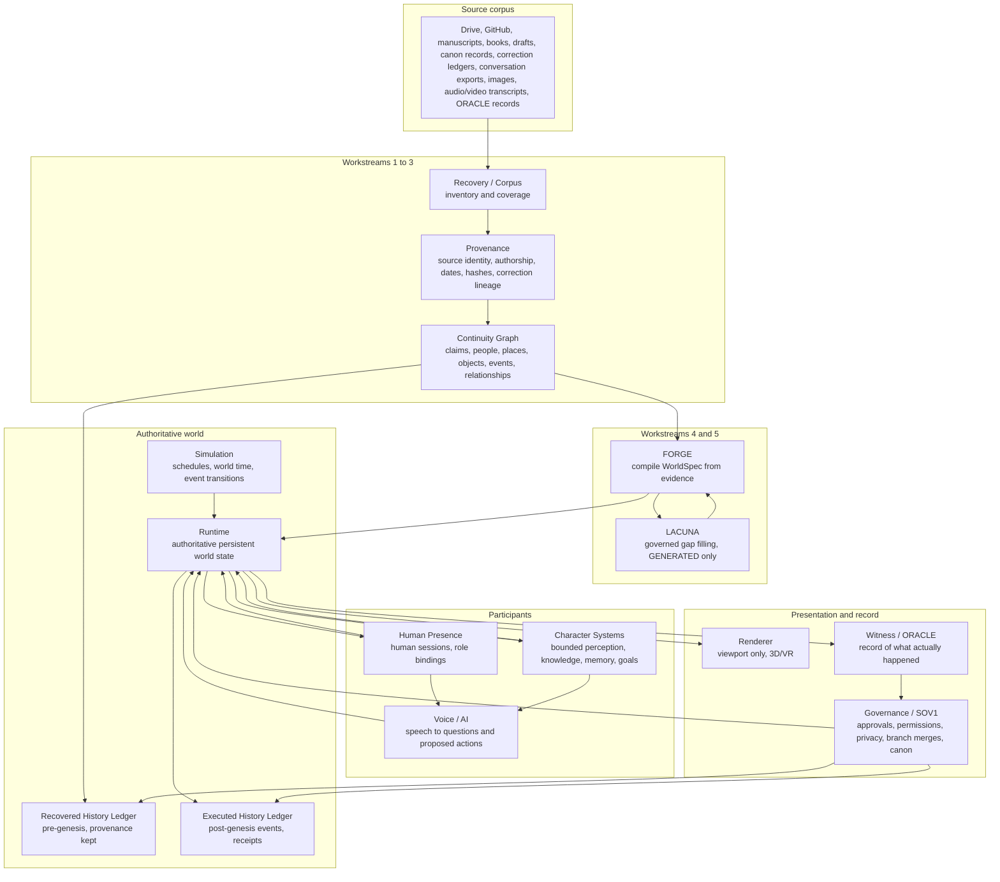

# RRE Genesis v0.1 Architecture

**Program:** Rendered Reality Open World (RRE Genesis)
**Version:** v0.1, architecture draft
**Date:** November 6, 2026
**Issued under:** Noah.Physical, Full-Team Reconstruction Directive, November 6, 2026
**Status:** DRAFT. Not adopted. Not canon. Architecture only; no runtime is claimed to exist by this document.
**Author:** Architecture designer, RRE Genesis team. Noah.Physical is the Creator and final authority.

## SCOPE NOTE

Read this before anything else in this document.

CC-90-001, the ninety-day Continuity Computing Executive Build Order issued November 4, 2026, explicitly excludes a Jupiter Station runtime and puts Voyager Sickbay first as the demonstration. RRE Genesis does not silently override CC-90-001. RRE Genesis is a separate program under the new November 6, 2026 directive. It reuses the CC-90-001 substrate: the frozen vocabulary (seven statuses, five authority roles), the four Sprint 1 ADRs, the threat model, the rights and privacy boundaries, and the verified PR #4 reference implementation. Its initial cell is Deck Nine of Jupiter Station, per directive section 21, not the whole station and not Voyager Sickbay. Sickbay remains the CC-90-001 demonstration; Deck Nine is the RRE Genesis vertical slice. The two programs share substrate and must not be confused with each other. Any conflict between this architecture and CC-90-001 is resolved in favor of CC-90-001 until Noah.Physical rules otherwise.

This architecture does not promote candidate fiction into canon. The Ellie canon merge of November 6, 2026 covers Ellie Hawkes only. All other fiction remains candidate until Noah.Physical adopts it explicitly. The six CC-90-001 Sprint 2 gating decisions are not assumed anywhere in this document. Where a decision would be needed, it is marked OPEN DECISION and the architecture does not build on an assumed answer.

No paid cloud spend. No public deployment. Private material stays out of public repositories, fixtures, and logs. These constraints come from CC-90-001 ADR-004 and ADR-003 and apply to RRE Genesis in full.

## 1. Governing rules

These rules are inherited from the CC-90-001 substrate and govern every workstream.

1. Rule 1: No overwriting. Corrections are additive. Originals stay inspectable.
2. Rule 2: Generated is not established.
3. Rule 3: Authority outranks coherence.
4. Rule 4: AI-assisted writing is still the Creator's writing. Authorship is not keystroke provenance. Rule 4 is about authorship; Rule 2 is about provenance. They must not be confused.
5. Supreme rule: The simulator never becomes the source of truth. Simulation can inform canon. Simulation cannot become canon on its own. Only the Creator promotes canon.

The frozen vocabulary applies unchanged: seven statuses (ESTABLISHED, RECONSTRUCTED, PROPOSED, SIMULATED, SUPERSEDED, REJECTED, UNKNOWN), no additions during the first 90 days; five authority roles (Creator, Editor, AI, Reviewer, Observer). A claim with status UNKNOWN and an empty sources array is the only permitted sourceless claim. Every other status requires at least one source.

The central law of the directive governs the whole design: RECONSTRUCT THE PAST. EXECUTE THE FUTURE. NEVER CONFUSE THE TWO.

## 2. System diagram

The diagram shows the full system. Arrows show the direction of data and authority flow. No workstream collapses the others into itself; each box is a separate responsibility with a stated interface, defined in section 3.

Reading the diagram: sources flow left to right through recovery into compilation and then into the authoritative world. Participants act only through the action path in section 4, never directly on state. The renderer and the witness read state; they do not write it. Governance sits above the ledgers and the runtime as the approval authority, not as a data path.

## 3. The thirteen workstreams

Directive section 29 names thirteen workstreams. Each is a separate responsibility. No workstream is allowed to collapse the others into itself. The table states each workstream's responsibility, its inputs, its outputs, and the interfaces it must honor.

### 3.1 Recovery / Corpus

Responsibility: find and inventory sources. Produce the source coverage report required by directive section 2: sources discovered, inspected, partially inspected, inaccessible, duplicates, version families, source hashes where actually computed, attribution certainty, privacy class, unresolved authorship, conflicts, stale historical state, current controlling corrections.

Inputs: the source list in directive sections 1 and 24, plus future user-provided sources.
Outputs: the coverage report, the source inventory, immutable source identities.
Interfaces: hands source identities to Provenance. Never claims complete ingestion without a receipt. The July 17, 2026 Document Atlas (8,391 records) is a seed map, not proof of complete recovery.

### 3.2 Provenance

Responsibility: assign source identity, authorship, dates, hashes, and correction lineage to every source. Preserve the distinction between transport and authorship: a passage pasted by Noah may have originated with Noah, another AI, another person, or an unknown source.

Inputs: source inventory from Recovery.
Outputs: provenance records attached to every claim; correction lineage; identity attribution for every contribution (see the companion identity model document).
Interfaces: feeds the Continuity Graph. Enforces the rule that every non-UNKNOWN claim carries at least one source. Marks carried material as carried, author unverified, until a receipt establishes it.

### 3.3 Continuity Graph

Responsibility: convert evidence into queryable claims, people, places, objects, events, and relationships. This is the CC-90-001 continuity core: sources, claims, statuses, assertions, authorities, revisions, relationships, per Sprint 1 ADR-001.

Inputs: provenance records.
Outputs: the claim graph with the seven frozen statuses; the recovered history ledger (section 6).
Interfaces: feeds FORGE. Answers provenance queries ("where did this come from?"). Never invents a claim to fill a gap; gaps are UNKNOWN.

### 3.4 FORGE

Responsibility: compile world structures from evidence into a WorldSpec. FORGE determines what physical and social structures can be reconstructed from the corpus. Example from the directive: the sources establish that Ellie's quarters contain books, a sweater, a plant, a mug, and an awkward antique desk; they may not establish exact wall materials.

Inputs: continuity graph claims.
Outputs: WorldSpec for the initial cell (section 10); per-object provenance answers ("This desk is established by Noah's November 1 Ellie record. Its exact wood species was not specified. The current texture was generated by FORGE.").
Interfaces: calls LACUNA for missing visual geometry; receives generated detail back marked GENERATED_VISUAL, never ESTABLISHED_CANON. Delivers the WorldSpec to the Runtime.

### 3.5 LACUNA

Responsibility: fill required gaps while preserving generated status. LACUNA generates details necessary to produce a coherent world when the corpus is incomplete, constrained by established architecture, period, style, nearby evidence, physical plausibility, story branch, cultural context, privacy rules, and existing canon.

Inputs: gap requests from FORGE.
Outputs: generated details, each labeled GENERATED (or GENERATED_VISUAL), each traceable to the gap it filled and the constraints applied.
Interfaces: returns generated detail to FORGE only. Never writes to the continuity graph, never writes to canon, never writes directly to world state. A generated choice becomes creator-approved only through the recorded transition GENERATED to CREATOR_APPROVED, by explicit Creator adoption. Repeated generation must never masquerade as corroboration.

### 3.6 Runtime

Responsibility: maintain authoritative persistent world state. The runtime is the only writer of world state. It owns the persistence ladder (section 7) and executes only validated actions (section 4).

Inputs: WorldSpec from FORGE; validated proposed actions from Voice / AI and from Simulation.
Outputs: state transitions; event receipts; answers to state queries.
Interfaces: the single choke point for all state mutation. All other workstreams propose; the runtime executes. Persists to the local store defined in the runtime ADR (section 11).

### 3.7 Character Systems

Responsibility: implement bounded perception, knowledge, memory, goals, and action proposals for character runtimes (Ellie Hawkes, Reg, Sorev, Brakk, Merlin, Mara Venn, the Doctor). Characters know what they witnessed, what they were told, what they learned through authorized sources, and what their established baseline permits. They do not receive every file in the archive. A character must be able to say "I don't know" even when the developer database contains the answer.

Inputs: world state (filtered through each character's bounded knowledge), executed events the character witnessed.
Outputs: proposed actions, dialogue, character memory updates.
Interfaces: proposes actions to the Runtime through the section 4 action path. Never mutates world state directly. Never reads another character's private memory or a human's private journals.

### 3.8 Human Presence

Responsibility: implement authenticated multi-user participation and role binding. Human sessions are a distinct entity type from character runtimes. The authoritative world server maintains participant identity, avatar, location, permissions, role bindings, private/public state, interactions, inventory, current session, and event history.

Inputs: human participants entering from their devices.
Outputs: session records; presence; shared object interaction.
Interfaces: sessions act through the section 4 action path. Two people in the same room see the same persistent object state. Full specification is in the companion identity model document.

### 3.9 Simulation

Responsibility: run schedules, world time, and event transitions for the world when participants are present and, where a scheduler exists, for asynchronous world life between sessions. Simulation tiers A, B, and C are defined in section 8.

Inputs: world state, schedules, tier assignments.
Outputs: proposed or executed world events, each with a receipt, each on a named branch.
Interfaces: executes through the Runtime. Never writes to canon. Never writes to the recovered history ledger. Simulated events carry status SIMULATED and a branch name.

### 3.10 Voice / AI

Responsibility: translate natural speech into questions and proposed world actions. The voice layer retrieves authoritative state or proposes actions. It does not improvise authoritative facts.

Inputs: spoken commands ("Computer, where is Ellie?", "Keep that.", "Don't make that canon.", "Revert the last world edit.").
Outputs: state answers with status and sources; proposed actions sent to validation.
Interfaces: queries go to the Runtime and the Continuity Graph; actions go through the section 4 action path. Voice commands that imply canon changes ("Keep that.", "Don't make that canon.") are routed to Governance as proposals, never executed as canon changes by the voice layer itself.

### 3.11 Renderer

Responsibility: display authoritative world state through 3D/VR. The renderer is a viewport, not the truth (section 9).

Inputs: authoritative world state from the Runtime.
Outputs: rendered scene.
Interfaces: read-only against world state. Changing graphics engines, rebuilding a room mesh, or changing a character model must not relocate an object in authoritative state without an explicit migration. For v0.1 the renderer is the dependency-free 2D blockout inherited from the PR #4 reference (ADR-003-RENDERING); a later React/Three.js renderer replaces it without changing the source or event model.

### 3.12 Witness / ORACLE

Responsibility: record what actually happened. The witness writes event receipts to the executed history ledger: what happened, who did it, who witnessed it, when it occurred, which branch it occurred in, what changed, and whether it came from authored history or executed history.

Inputs: state transitions from the Runtime.
Outputs: append-only event receipts, hash-chained where the reference implementation supports it.
Interfaces: read-only against world state; append-only against the executed ledger. The witness never edits a receipt. A correction is a new receipt that references the old one.

### 3.13 Governance / SOV1

Responsibility: maintain approvals, permissions, privacy, branch merges, and canon decisions. Governance is the only path by which a SIMULATED or GENERATED item becomes ESTABLISHED or CREATOR_APPROVED, and only by explicit Creator action recorded as a revision with the Creator as authority.

Inputs: merge proposals, canon promotion requests, privacy and consent records, conflict reports.
Outputs: approvals, rejections, merge decisions, canon rulings, privacy rulings.
Interfaces: governs the Runtime (permissions), both ledgers (what may be promoted), and the branch model (section 5). Governance does not generate content, does not simulate, and does not render. It decides.

## 4. The action path (directive section 15)

Every state change in the world follows this path, without exception. An AI sentence cannot directly mutate world state.

1. Human or character intent. A participant intends something: Noah moves a mug; Ellie proposes to answer a question; a schedule fires.
2. AI interpretation. A language model or a character system interprets the intent into a structured proposed action. Interpretation is not execution.
3. Proposed action. The proposal is a record: actor, action, target, parameters, branch, and the identity attribution of the proposer.
4. Permission / feasibility / continuity validation. The Runtime, with Governance rules, checks: does the actor have permission; is the action feasible in the current world state; does it contradict established continuity. A failed check rejects the proposal and records the rejection with its reason. Rejection is itself part of the history.
5. World execution. Only now does the Runtime execute the action against authoritative state.
6. State transition. The prior value and the new value are recorded together.
7. Event receipt. The Witness writes a receipt in the same transaction as the change where the store supports it: what changed, prior and new value, who authorized it, with what authority, the sources behind it, the time, and the branch.
8. Memory update. Character memory and human-visible history update from the receipt, not from the AI sentence that proposed the action.
9. Rendering. The Renderer displays the new state.

Consequences of this path:

- An AI sentence cannot move a door. A validated world action can.
- If validation fails, nothing changes and the failure is on the record.
- If the receipt cannot be written, the change does not happen (where the store supports atomic receipt and change; see OPEN DECISION D-3).
- Voice commands, character dialogue, and simulation ticks all enter at step 1 or 2. Nothing enters at step 5.

## 5. Branches (directive section 19)

Rendered Reality needs version control for worlds. Five branch types, minimum:

| Branch | Purpose | Rules |
| --- | --- | --- |
| HOME | The authoritative lived world. The family's home state. | Only validated actions from authorized participants land here. Only the Creator promotes material into HOME canon. |
| SANDBOX | Exploration. "Show me what this promenade might look like if..." | Free exploration. Must not contaminate HOME. Sandbox state is disposable unless merged by proposal. |
| EXPERIMENT | Controlled tests of a hypothesis or a design. | Named, time-bounded where possible, with a stated question. Results are SIMULATED. |
| CANDIDATE | Material proposed for adoption. | Holds merge proposals and promotion requests awaiting a Creator ruling. Nothing in CANDIDATE is canon. |
| ARCHIVED | Retired branches and superseded states. | Read-only. Preserved for audit, never deleted. |

Rules:

- Every world write names its branch. A write with no branch is rejected.
- A child branch never writes into its parent. Sandbox exploration must not contaminate HOME.
- A "keep it" from Noah produces a reviewable merge proposal, not a silent merge. The proposal goes to Governance, is recorded, and waits for Creator approval. Approval is a recorded transition with the Creator as authority.
- Promotion from any branch to HOME canon is an explicit Creator action, recorded as a revision. The PR #4 reference implementation enforces this by returning 403 for HTTP canon promotion and by requiring simulation branch IDs prefixed `sim-`; RRE Genesis keeps that enforcement and extends it to all five branch types.
- Branch naming and listing rules are OPEN DECISION D-1 (carried from CC-90-001 ADR-002, which records the branch naming rule as open).

## 6. The two histories (directive section 9)

The world has two histories. They live in separate ledgers. They are never blurred.

### 6.1 Recovered history

Everything derived from pre-genesis source material: manuscripts, creator statements, approved canon, corrections, old story events, room descriptions, character history. Every recovered element keeps provenance: source identity, locator, status, authority, and correction lineage. Recovered history is read from the Continuity Graph. It answers "what was authored and what do we know about the past." It is not a record of things that happened in the executing world.

### 6.2 Executed history

Everything that actually occurs after the persistent simulation begins: Noah moved a mug; Ellie spoke with Mara; Ashley approved a docking request; Ethan visited Engineering; Noah and Ender entered a holodeck; Avalon departed berth twelve; a player left an object in a corridor. These events are not invented retrospective biography. They happened in the executing world and receive event receipts from the Witness.

Rules:

- A recovered claim and an executed event are different record types in different ledgers. No query may return one as if it were the other.
- A simulated event does not automatically become recovered canon. A beautiful simulated event is still SIMULATED.
- Every executed event records: what happened, who did it, who witnessed it, when it occurred, which branch it occurred in, what changed, and whether it came from authored history or executed history. The answer to "how did the mug get here?" is an executed event, or an honest UNKNOWN if no event exists.
- Corrections to either ledger are additive. A correction appends; it does not overwrite.

## 7. The persistence ladder (directive section 16)

Persistence is proven one rung at a time, in order. No rung is claimed until it is demonstrated with a cold-restart receipt.

1. Object state. Place a mug in Ellie's quarters. Record its position. Stop every process. Cold restart. Return. The mug is still where it was left. The system returns the executed event that put it there.
2. Conversation memory. Conversations survive restart. A character can recall what was said to it, by whom, and when, within its bounded knowledge.
3. Commitments. A promise or agreement made in the world survives restart and remains binding on the record until fulfilled, released, or superseded.
4. Relationships. Relationship state between participants and characters survives restart and reflects executed history, not generated biography.
5. Schedules. Scheduled events and routines survive restart and fire from the actual scheduler, with receipts.
6. Independent action. Characters act on their schedules and goals without a human present, and each action leaves a receipt.

The persistent mug is the atom of the open world. It is not trivial. Rung 1 is the v0.1 gate: no claim about higher rungs is made until rung 1 passes with a cold-restart receipt.

## 8. Simulation tiers and the rule against faking activity (directive section 17)

Do not fake activity while the runtime is stopped. If the world is paused, say it is paused. If persistent time progression is implemented, there must be an actual scheduler. Every simulated interval requires receipts. Do not run 90,000 LLMs continuously.

| Tier | Population | Fidelity |
| --- | --- | --- |
| A | Human participants and central characters (Noah, Ashley, Ellie, Reg, and the other named Genesis characters when active). | High-fidelity state and reasoning. Full character systems, bounded knowledge, memory, goals. |
| B | Recurring secondary characters. | Event-driven cognition. A character reasons when an event involves it, not continuously. |
| C | Background residents. | Schedules, state machines, and statistical simulation. No per-resident reasoning model. |

Rules:

- Promote an entity temporarily when detailed interaction requires it. Demote after interaction while preserving state. Promotion and demotion are recorded.
- A Tier C resident must never be presented as having had a detailed conversation or made a reasoned decision it did not have. Statistical simulation produces aggregate or scheduled behavior, and the record says so.
- No claim that non-player characters continued acting while the software was stopped, unless an actual running process or recorded simulation generated those events.
- The scheduler, if implemented, is a real component with a real clock and real receipts, not a narrative device. Whether v0.1 implements a running scheduler or a paused world with explicit resume is OPEN DECISION D-4.

## 9. The renderer as viewport, not truth (directive section 20)

Unreal, Unity, Godot, WebXR, or future spatial systems may render the environment. The renderer receives authoritative world state. It does not decide canon. Changing graphics engines must not erase history. Changing an Ellie character model must not erase Ellie's memories. Rebuilding a room mesh must not relocate an object in authoritative state without an explicit migration.

For v0.1 the renderer is the dependency-free mobile 2D blockout inherited from the PR #4 reference implementation: scene navigation, evidence drill-down, era switching, branch mode, persistence. A later React/Three.js renderer replaces the presentation layer without changing the source model, the claim graph, or the event model. The renderer is read-only against world state. Any renderer-side cache is invalidated on state transition; a stale render is a display bug, not a world fact.

## 10. The initial world cell (directive section 21)

Do not model all of Jupiter Station first. The v0.1 vertical slice is one persistent cell:

1. Hawkes family quarters on Deck Nine.
2. Ellie's quarters.
3. Adjacent residential corridor.
4. Ellie's observation alcove.
5. Turbolift.
6. Station command access.
7. Avalon's docking connection.
8. Avalon's bridge.

Recovered details for the Hawkes quarters in the directive include curved residential geometry, warm domestic lighting, Jupiter dominating the windows, Avalon visible outside, wood-grain cabinet fronts, a functional kitchen, family objects, an animal feeding area, a holographic backyard threshold, a patio, grass and trees inside the program, domestic clutter, family preferences, and station life visible outside. Each detail is treated according to its source status. Prose is not automatically converted into canon geometry without provenance. Details with no established source are FORGE or LACUNA output, labeled GENERATED, until the Creator adopts them.

Current governing relationship for the cell: Captain Ashley Hawkes independently commands Jupiter Station. Captain Noah Hawkes commands USS Avalon, NCC-75154. The Hawkes family lives aboard Jupiter Station. Jupiter Station is home. Avalon is Noah's mission command. The older July state in which Noah commanded both is historical only and must not be resurrected. The station and Avalon have separate authority and evidence custody.

## 11. Runtime ADR: Node.js with node:sqlite and zero dependencies

### ADR-RRE-001: v0.1 runtime on Node.js with node:sqlite, zero dependencies

Status: Proposed for RRE Genesis v0.1. This is a new ADR for this program. It does not revise CC-90-001 ADR-001 (Postgres for the Sprint 2 core) or ADR-002 (Node.js/TypeScript core service). It scopes a v0.1 local runtime on top of the verified reference implementation. The Postgres target from ADR-001 remains the CC-90-001 Sprint 2 core decision; the v0.1 runtime below is the local proof that precedes it, exactly as the PR #4 reference did.

Context: RRE Genesis v0.1 must demonstrate the full action path, the persistence ladder rung 1, the branch model, and the two ledgers in one integrated local system, with no install step, no paid services, and no network. The PR #4 reference implementation already proves the core mechanics on this exact stack.

Decision: Build the v0.1 runtime in Node.js using the built-in `node:sqlite` module, with zero npm dependencies.

Justification:

- It reuses the verified PR #4 reference implementation: 12/12 unit tests passing on Node v22.16.0, November 4, 2026, covering constitutional negative tests T01-T07, the creator credential gate, ESP validation, the simulation hash chain, and timeline routing. Cold restart is verified in that reference: the SQLite file is created on first start and state survives process stop and restart.
- It needs no install. No `npm install`, no package registry, no network fetch. A reviewer can run `npm test`, `npm run check`, and `npm start` and reproduce the result on the same machine.
- It needs no paid services and no network. The server binds to 127.0.0.1 by default. Nothing is reachable from the public internet. This satisfies ADR-004 (no paid cloud spend, no public deployment) by construction rather than by policy alone.
- Append-only enforcement already exists in the reference: UPDATE and DELETE on history tables are blocked by SQLite triggers. Simulation events live in a separate append-only table, require `sim-` branch IDs, and cannot write assertions. Canon promotion over HTTP always returns 403.
- The schema and HTTP contracts are portable to the Postgres target defined in ADR-001. The reference ships the Postgres migration with role-based creator gate and append-only triggers, not yet executed against a live instance. Portability is a design property of the reference, not a claim that the migration has run.

Consequences, good:

- Reproducible local proof with no external dependency. Any machine with Node 22 can run it.
- The same runtime serves the mug test, the branch test, the two-ledger test, and the Ellie memory test.
- Zero supply-chain surface: no third-party packages to audit, update, or compromise.

Consequences, costs and limits:

- SQLite is not a substitute for Postgres security roles or production multi-user concurrency. Multi-user presence in v0.1 is local and sequential; concurrent writes from several devices are not proven and must not be claimed. See OPEN DECISION D-2.
- The reference HTTP API has no authentication for local simulation writes. It must not be exposed beyond localhost. This is a local prototype boundary, not a production boundary.
- The Postgres migration has not been executed against a live Postgres instance. The migration path stays open and unexecuted until a Sprint 2 decision authorizes it.
- Hash-chained simulation events are not independently anchored and are not tamperproof against a privileged attacker. The chain proves ordering and detects casual edits; it does not prove tamper resistance.

Alternatives considered:

- Postgres now, per ADR-001. Rejected for the v0.1 runtime because it requires a running Postgres service, provisioning, and role setup that the local proof does not need yet. The Postgres target stands for the Sprint 2 core. The v0.1 runtime is the local proof that precedes it.
- Python core service. Rejected for the same reasons recorded in ADR-002: it would split the type system between server and client and add a second stack for a prototype that does not need it. Python remains available for offline ingestion scripts that feed the runtime through its API.
- A hosted or cloud runtime. Rejected. No paid cloud spend is authorized and no public deployment is planned. A hosted runtime would also break the cold-restart proof, which requires the operator to stop and start the actual local process.

Open questions carried from the reference: the exact JSON shape of each endpoint response belongs in the schema; the promotion step needs a specification before any promotion route is enabled; the branch naming rule needs to be written before new branch types are added.

## 12. Data and storage

Three layers, inherited from CC-90-001 ADR-003:

- Git is the source of truth for documents and schema. ADRs, specifications, and migration files live in the repository. Changes arrive as commits on a branch, reviewed before they land. The repository is public, so no private family history and no unpublished manuscripts enter it, its fixtures, or its logs. This rule is absolute.
- The local SQLite database (v0.1) is the store for continuity data and world state: sources, claims, assertions, revisions, relationships, simulation events, custody receipts, world objects, sessions, and event receipts. The runtime service is the only writer. Append-only versioning applies in every table that holds history. The Postgres target from ADR-001 remains the Sprint 2 core store; v0.1 does not replace that decision.
- Local client storage is acceptable for client persistence (era, location, mode, visited places), per ADR-003. It has no backup in v0.1. That is accepted. Client state is small and rebuildable. It must never be treated as authoritative world state; the server database is authoritative.

The private data rule applies to all three layers. Fixtures use invented data. Logs carry ids, statuses, and counts, never full source text from private material. When the status of a piece of material is unclear, treat it as private and ask the Creator.

## 13. What is NOT built in v0.1 (directive section 28)

Do not spend the early milestone on any of the following. Listing them here is a scope boundary, not a roadmap promise.

- Photorealistic 90,000-person population simulation.
- Complete station geometry.
- Expensive proprietary assets.
- Custom headset hardware.
- Unsupported autonomous consciousness claims. Do not claim the system or any character is conscious or sentient.
- Simulated family doubles without consent.
- Exhaustive NPC cognition.
- Perfect cinematic visuals.
- Speculative physics.
- Automatic canon promotion.
- Invisible background events without receipts.

Prove continuity first. Expand fidelity second.

## 14. First milestone acceptance (directive sections 26 and 27)

RRE Genesis v0.1 must demonstrate all fifteen properties in one integrated system: ingest a bounded set of actual Noah sources; create immutable source identities; extract claims with source locators; preserve UNKNOWN; compile one persistent world cell; visibly distinguish established and generated details; instantiate Ellie with bounded knowledge; allow Noah.Physical to enter; permit a second authenticated human participant; allow shared object interaction; persist the resulting state across cold restart; allow Ellie to remember an executed interaction; let the user ask why an object or fact exists and receive provenance; keep source records unchanged; write executed simulation events to a separate ledger.

The test scenario: Noah enters Ellie's quarters. Ellie is present or the world truthfully says where she is. Noah asks a question whose answer is established in source material; Ellie answers using information legitimately available to her. Noah asks a question whose answer remains unresolved; Ellie says she does not know. Noah moves a mug. Ashley.Physical joins the same world instance and sees the mug in its moved position. Noah leaves. Processes are cold-restarted. Ashley or Noah returns. The mug remains moved. Ellie remembers the executed encounter if she witnessed it. The system can answer what happened, who did it, who witnessed it, when it occurred, which branch it occurred in, what changed, and whether it came from authored history or executed history.

If this works, the architecture is real enough to grow. Do not expand Jupiter Station until this passes.

## 15. Open decisions

These are left unresolved. The architecture does not build on an assumed answer to any of them.

- OPEN DECISION D-1: Branch naming and listing rules. Carried from CC-90-001 ADR-002. Needed before new branch types beyond the five named here are added, and before the promotion endpoint is specified.
- OPEN DECISION D-2: Multi-user concurrency. The v0.1 runtime is local and sequential. Whether concurrent writes from several devices are supported in v0.1, and by what locking or serialization, is undecided. Until decided, simultaneous writes from two devices must not be claimed to work.
- OPEN DECISION D-3: Receipt atomicity in the v0.1 SQLite store. ADR-002 requires the receipt in the same transaction as the change. The PR #4 reference implements hash-chained simulation events; whether every world state change and its receipt share one SQLite transaction in v0.1 needs verification against the reference code before the claim is made.
- OPEN DECISION D-4: Paused world versus running scheduler. Whether v0.1 implements a real scheduler for asynchronous world life, or a paused world with explicit resume and no faked activity, is undecided. Either is acceptable; faking activity is not.
- OPEN DECISION D-5: The six CC-90-001 Sprint 2 gating decisions. Noah.Physical has not ruled on them. This architecture assumes none of them. Any Sprint 2 decision that changes the substrate (database, runtime language, deployment, storage) will require a revision to this architecture by a new ADR that preserves this record.
- OPEN DECISION D-6: The trajectory model (Identity plus History plus Trajectory). Pending Creator approval. It is not the governing architecture. It is documented as a proposed extension in the Sprint 1 schema README, not in the frozen vocabulary. Adopting it later requires a new ADR.
- OPEN DECISION D-7: Disputed roles and identities, including conflicting Brooklyn roles in older fiction. Preserved as UNKNOWN until Noah.Physical rules. No disputed role is hard-coded in v0.1.
- OPEN DECISION D-8: Whether a temporary development tunnel is acceptable for any device test, or local-network-only. Carried from CC-90-001 ADR-004. Until Noah rules, local network only.

## 16. Threats carried forward

The Sprint 1 threat model applies to RRE Genesis in full. The threats most load-bearing for this architecture are: (b) AI promoting canon, mitigated by the branch rule and the Governance workstream; (e) transport contamination, mitigated by the receipt protocol and carried-material labeling; (f) private data leakage into the public repo, mitigated by the private data rule and review before push; (g) self-grading, mitigated by reporting what tests showed rather than declaring work green; (h) simulation contaminating canon, mitigated by separate ledgers and branch isolation. The open risks from the threat model remain open: the pre-commit private-data check does not exist yet; the receipt reviewer is not named; the integration tests named in the threat model do not exist yet and are Sprint 2 work.

## 17. Deliverables status

This document is deliverable 5 of directive section 30 (RRE Genesis architecture diagram). The companion identity model document is deliverable 7 (multi-user identity model). The remaining deliverables (corpus coverage report, source priority map, conflict register, canon/world-state manifest, database/event schema, Ellie Genesis package, first WorldSpec, executable proof, tests, cold-restart receipt, screenshots/video where actually produced, GitHub branch/PR with exact commit receipts, UNKNOWN list) do not exist yet. This document does not substitute a plan for an implementation receipt. No runtime is claimed to exist by this document.
